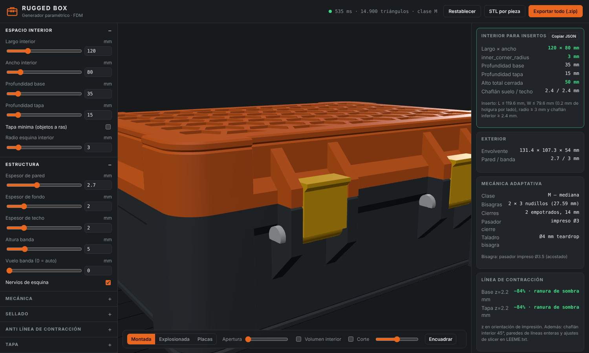
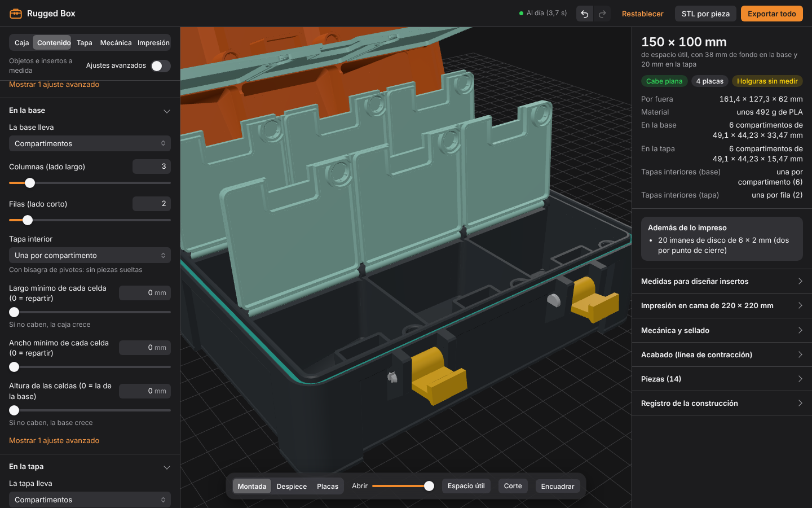

# Rugged Box

**English** · [Español](README.es.md)

**Parametric generator for 3D-printable rugged boxes (FDM).**
Set the inside dimensions and get, in real time, a complete box with hinges,
self-locking latches, a watertight gasket and compartments, ready to print
**with no supports and no hardware**.

**[Open the generator in your browser](https://parra0713.github.io/parametric-rugged-box/)** · [Download the latest release](https://github.com/Parra0713/parametric-rugged-box/releases/latest)

[](LICENSE)
[](https://github.com/Parra0713/parametric-rugged-box/releases/latest)


## Contents

- [Features](#features)
- [Getting started](#getting-started)
- [How to use it](#how-to-use-it)
- [Printing](#printing)
- [Development](#development)
- [How it works](#how-it-works)
- [Contributing](#contributing)
- [License and credits](#license-and-credits)

## Features

**The box**

- **Inside** dimensions as input, with separate depths for the base and the lid.
- Knuckle hinges and **self-locking hook latches**, scaled automatically to
  the box size (20 to 380 mm).
- Seal options: **printed TPU gasket**, **1.75 mm TPU filament cord**
  (nothing to print), double labyrinth or simple tongue and groove.
- Rounded or **octagonal** corners, corner ribs, **stackable** and
  **Gridfinity** compatible (baseplate inside or feet).
- Plain, hexagon, stripes, cross-braced or sci-fi lid, plus **your own SVG
  logo**, engraved or embossed.
- **Material saver** with a ribbed design that keeps the stiffness.

**The contents**

- Base and lid each hold, independently: nothing, a **blank insert**, an
  **insert with custom cutouts** for your items, or **compartments** with
  their own lids. Any combination.
- Custom cutouts from an **SVG tracing** of each item (1:1 scale). Several
  items get packed in the smallest space automatically, with finger cutouts.
- Compartment lids with pivot hinges, a finger well and a **snap-fit** or
  **magnetic** latch (press-fit disc magnets in the size you pick, with a
  suggested count or your own).

**Printing**

- Every part comes out **oriented and support-free**: teardrop holes,
  overhangs ≤ 45° and bridges ≤ 10 mm.
- If a part doesn't fit flat, it goes **diagonal** with easy-to-snap-off
  mouse ears, or **tilted** with a contact bevel, support fins and supports
  built into the STL.
- **Tolerance test**: test pieces that reproduce each joint in its real
  print orientation; the result is saved as a profile for your printer.
- A shadow groove hides the shrink line between floor and walls.

**The app**

- A single `.html` file: no install, works offline.
- 3D view assembled, exploded or as print plates, with an animated opening
  and a cross-section.
- English and Spanish (more languages are easy to add), undo and redo,
  light and dark mode, full keyboard support.
- Exports STL per part or per plate plus a `README.txt` with slicer
  settings, assembly steps and everything you need to buy or cut.

| | |
|---|---|
|  |  |
|  |  |

## Getting started

### In the browser

Open **https://parra0713.github.io/parametric-rugged-box/**. Nothing is sent
to any server: the box is computed in your browser and your settings are
only stored there. The language follows your browser; you can change it
in the top bar or with `?lang=en` / `?lang=es`.

### Offline

1. Download `rugged-box-vX.Y.Z.html` from the
   [latest release](https://github.com/Parra0713/parametric-rugged-box/releases/latest).
2. Double-click it to open it in Chrome, Edge or Firefox.

The whole program, geometry engine included, lives in that one file.

### From source

Requires [Node.js](https://nodejs.org/) 20 or newer.

```bash
git clone https://github.com/Parra0713/parametric-rugged-box.git
cd parametric-rugged-box
npm install
npm run dev      # http://localhost:5173 with live reload
npm run build    # builds dist/rugged-box.html
```

## How to use it

1. **Box**: enter the inside space you need and the shape.
2. **Contents**: choose what goes in the base and in the lid. For custom
   cutouts, add an SVG tracing of each item.
3. **Lid**: pattern and logo.
4. **Mechanics**: seal type and size class (auto by default).
5. **Printing**: your bed and, once per printer and filament, the tolerance
   test.
6. **Export all**: open the plates in your slicer.

The right panel sums up how each part will print, any warnings and what you
need besides the printed parts (magnets, cord, filament for pins).

## Printing

| Part | Material | Recommended |
|---|---|---|
| Base and lid | PETG, ASA or PLA | 0.2 mm layers, 4–6 walls, 15–25% gyroid. Lid with the decorated face on the bed. |
| Latches | PETG | Lying down, as exported; 5+ walls. |
| Pins | PETG or PLA | Lying on the flat face, 100% infill. |
| Printed gasket | TPU 95A | Slow, 100% infill. With "cord" there's nothing to print: you cut filament. |
| Compartment lids | PETG or PLA | Outer face on the bed, 3+ walls. |
| Inserts | PLA | 2 walls, 0% infill. |

Every export includes a `README.txt` with the settings and assembly steps
for that specific box.

## Development

```bash
npm test               # geometry, bed, assembly, performance, memory, UI and translations
npm run test:sweep     # sweep from 20 to 380 mm (results in logs/)
npm run test:org       # compartments: close, open 0–95°, no supports
npm run test:ui        # UI in a real browser (needs Playwright)
npm run i18n           # translation check
```

```
index.html, src/main.js, src/viewer.js   UI and 3D view (three.js)
src/i18n/                                languages: es.js (source), en.js
src/worker.js, src/engineClient.js       geometry threads
src/engine/params.js                     parameters, UI schema and limits
src/engine/engine.js                     part orchestration and print helpers
src/engine/*.js                          hinges, latches, seal, lid, inserts,
                                         compartments, calibration, tilting
src/packer.js, src/content.js            item packing and SVG tracing import
tests/                                   Node and browser tests
docs/                                    design notes and UI guide (Spanish)
```

## How it works

Geometry is built with [manifold-3d](https://github.com/elalish/manifold)
(the CSG engine OpenSCAD also uses) compiled to WebAssembly, in worker
threads so the UI never freezes. Each change first shows a quick preview
(~0.1 s) and then the full model when you let go of the control.

Every design decision (hinge geometry, self-locking latch, gasket sizing,
tilted printing, material saver, calibration, compartments and latches) is
explained in **[docs/DISENO.md](docs/DISENO.md)** (Spanish).

## Contributing

Issues and pull requests are welcome. Before opening one:

- Run `npm test` and, if you touch `src/engine/`, also `npm run test:sweep`.
- If you change the UI, follow the [UI guide](docs/GUIA-INTERFAZ.md) and
  run `npm run test:ui`.
- A new feature adds its case to `tests/budget.test.mjs` (performance budget).
- Every new UI text goes in `src/i18n/locales/es.js` and `en.js`.

### Adding a language

1. `npm run i18n:new -- fr` creates `src/i18n/locales/fr.js` with every key,
   starting from the English text.
2. Translate it using the words makers use in that language (what the
   slicers and forums say: walls, infill, brim, overhang…). Keys you leave
   out fall back to English.
3. Add one line to `LOCALES` in `src/i18n/index.js`.
4. `npm run i18n` and `npm test` must pass.

### Releases

Bump `version` in `package.json` and `VERSION` in `src/engine/params.js`,
build (`npm run build`), write the notes in `docs/releases/vX.Y.Z.md` and
push the tag (`git tag vX.Y.Z` and `git push --tags`). The release and the
site update themselves.

## License and credits

[MIT](LICENSE).

Ideas and references from the community: Whity's
[Rugged Storage Box](https://printables.com/model/637028-rugged-storage-box-parametric-and-customizable),
the [Gridfinity Rugged Storage Box](https://www.printables.com/model/757297-gridfinity-rugged-storage-box-parametric-and-custo),
the [Parametric Tough Box](https://www.printables.com/model/731210-parametric-tough-box),
Zack Freedman's [Gridfinity](https://gridfinity.xyz/) and
[gridfinity-rebuilt-openscad](https://github.com/kennetek/gridfinity-rebuilt-openscad),
M. Trahan's [support fins](https://github.com/gittrahan/support-fins/wiki)
and Apple's
[Human Interface Guidelines](https://developer.apple.com/design/human-interface-guidelines/).
Full list in [docs/DISENO.md](docs/DISENO.md#fuentes).
