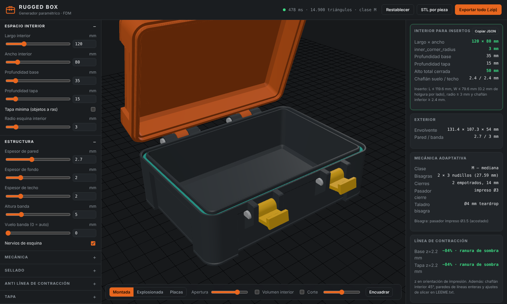
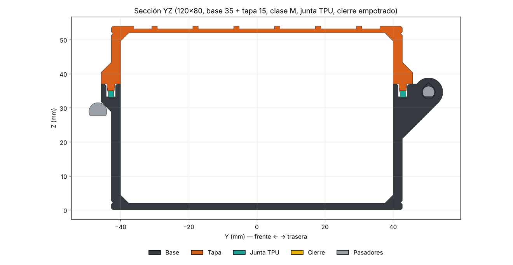

# Rugged Box — generador paramétrico de cajas de alta resistencia (FDM)

Aplicación web local que genera, en tiempo real, cajas tipo *rugged box*
100 % imprimibles: base, tapa con bisagra, cierres autobloqueantes, junta
hermética en TPU y pasadores, sin tornillería.




---

## Fase 1 — Tecnología elegida y por qué

| Requisito | OpenSCAD | CadQuery | JSCAD | **three.js + manifold‑3d (WASM)** |
|---|---|---|---|---|
| Vista en tiempo real | ✗ (render CGAL en segundos/minutos) | ✗ (Python + OCCT, sin UI propia) | ~ (CSG lento en JS puro) | **✔ 100–300 ms por reconstrucción** |
| Importar SVG directo | ~ (`import()`, sin control de trazos) | ~ (vía librerías extra) | ~ | **✔ SVGLoader: rellenos, agujeros y trazos** |
| Memoria / CPU | Alto en booleanas | Alto (OCCT ~200 MB) | Medio | **Bajo: núcleo C++ en WASM de 540 KB, memoria liberada en cada ciclo** |
| Mallas siempre válidas | ~ | ✔ (B‑rep) | ✗ (errores frecuentes) | **✔ manifold garantiza mallas cerradas** |
| Instalación | Programa aparte | Python + conda | Node | **Ninguna: un único `.html`** |

**manifold‑3d** es el motor CSG que también usan OpenSCAD (backend *Manifold*,
10–1000× más rápido que CGAL) y Blender; compilado a WebAssembly corre en un
*Web Worker*, de modo que la interfaz nunca se congela. La vista usa
three.js con **render bajo demanda** (0 % de GPU con la vista quieta) y el
cliente aplica la política **"último pedido gana"**: al arrastrar un
deslizador nunca se acumulan cálculos atrasados.

### Soluciones mecánicas (resumen de la investigación)

* **Bisagra de nudillos alternados con el eje a la altura de la punta de la
  lengüeta.** Un punto a altura *c* sobre el eje se desplaza *c·θ* en
  horizontal al abrir; con el eje en la punta, la lengüeta sale casi vertical.
  El término de segundo orden *a(1−cos θ)* lo absorbe un chaflán de 0.6 mm en
  la ranura. Verificado: 0 mm³ de interferencia de 0° a 180°.
* **Pasadores según tamaño (mecánica adaptativa):**
  *S* (< 90 mm) → filamento 1.75 mm + tapones impresos (un filamento extruido
  no tiene uniones entre capas y resiste ~3× más que un pasador impreso de
  igual diámetro); *M/L* → pasador impreso **acostado** (capas a lo largo del
  eje; impreso de pie se parte por la unión entre capas, 40–60 % más débil),
  con cara plana en "D" y punta partida con dientes que flexionan en el plano
  XY. Diámetro, radio de nudillo, número de bisagras/cierres y vuelo de banda
  escalan con la clase.
* **Cierre de gancho autobloqueante:** el pivote está por dentro de la cara de
  la banda, así que la reacción de la junta genera un par que lo **cierra**
  contra su tope; abrirlo exige comprimir más la junta (barrera de energía).
  Se imprime de lado: la flexión de la placa ocurre dentro de cada capa.
* **Sellado:** lengüeta y ranura (*tongue & groove*) con junta TPU 95A
  dimensionada con las reglas de juntas estáticas: **compresión 25 %** y
  **llenado del alojamiento ≤ 85 %** (el elastómero es casi incompresible).
  El contacto cara contra cara de tapa y base es el tope duro que fija esa
  compresión. Alternativas: laberinto doble o lengüeta simple.
* **Tolerancias:** 0.25 mm radial en ajustes deslizantes, 0.4 mm axial entre
  nudillos, agujeros horizontales en *teardrop* (45°) y todos los voladizos
  ≤ 45° → **sin soportes** en ninguna pieza.
* **Línea de contracción ("Benchy hull line") — ataque en 4 frentes.**
  Causa (Prusa Knowledge Base y foros Bambu/Prusa): en la transición de
  relleno macizo a solo paredes el tiempo de capa cae de golpe; el último
  macizo se contrae tirando de los perímetros y la capa siguiente se imprime
  más caliente. Aparece justo encima del fondo macizo.
  1. **Gradiente geométrico:** chaflán interior de 45° suelo/pared y
     techo/pared; banda y bloques con chaflanes de 45° (el área por capa
     cambia gradualmente).
  2. **Desacople:** paredes = número entero de líneas de extrusión (sin
     relleno ni *gap fill* pegado al perímetro exterior) y espesores
     horizontales = capas enteras.
  3. **Detección y ocultación:** el programa corta la pieza capa a capa en su
     orientación de impresión, localiza las caídas de área > 40 % y coloca
     una ranura de sombra en V exactamente en esa altura (en la base y la
     tapa). El panel muestra cada altura crítica y cómo quedó resuelta.
  4. **Ruptura visual + ajustes de slicer:** nervios de esquina y, en el
     `LEEME.txt`, perímetro exterior primero, flujo de macizo 95 % y tiempo
     mínimo de capa.
* **Cierres empotrados y cortos:** el barril se aloja en un hueco local bajo
  la ranura de la junta y el cierre queda al ras de dos mejillas; el retén de
  la tapa es una barra-puente entre ellas. ~25 % más corto que la v1.
* **Mecánica siempre en el lado largo** y reparto adaptado a la longitud
  disponible (número y ancho de cierres/bisagras).
* **Impresión en diagonal o inclinada (diseño diferencial):**
  - Si cabe girada en Z, se coloca en diagonal y se añaden **orejas** de 2
    capas en las esquinas (donde empieza el despegue por contracción).
  - Si solo cabe inclinada, se **prefieren 45°**: fondo y paredes quedan en el
    límite de voladizo imprimible sin soporte.
  - **Bisel integrado y simétrico:** el corte de contacto se convierte en un
    chaflán del diseño aplicado a las **cuatro** aristas inferiores (base) o
    superiores (tapa) a la misma distancia: la pieza queda simétrica y el
    bisel también se ve en el ensamblaje. Se elige el eje de inclinación
    que deja el apoyo en los lados cortos (sin bisagras ni cierres).
  - **Corte diagonal de contacto:** la arista que tocaría la cama se bisela
    con un plano paralelo a ella, hasta la franja más ancha que no se acerque
    a la cavidad a menos de un espesor de pared (en una tapa de 250×170:
    ~5 mm × 190 mm ≈ 930 mm² de apoyo en vez de una línea).
  - **Aletas de soporte** (inspiradas en las *support fins* de Slant3D /
    M. Trahan y el soporte perimetral con puentes de KNIN): láminas de 2
    líneas perpendiculares al eje de inclinación, con celosía a 45°, pie de
    2 capas, holgura con la pieza y **dientes de 1 línea cada 6 mm** como
    único contacto. Solo llegan un poco más allá del centro de masa: las
    caras a 45° se sostienen solas y el material de la aleta crece con el
    cuadrado de su altura. Resultado: ~3–5 % del material de una cuña maciza.
  - La junta TPU se divide en tramos si no cabe entera.
* **Soportes en el STL y dentro de la cama:** por defecto las ayudas se
  exportan en el mismo STL que la pieza (`*_con_soportes.stl`) y la pieza se
  centra sola en su placa; las orejas se recortan al área imprimible.
  Ajustes mínimos: modo (automático / sin aletas / desactivado), separación
  y alcance de las aletas, paso de los dientes y holgura.
* **Contenedor a medida desde el calco SVG:** sube el contorno de tu pieza
  (SVG 1:1, respeta mm/cm/in/px). El programa ajusta el interior al
  rectángulo de área mínima (+ holgura) y calcula cuánto se pueden recortar
  las esquinas sin tocarla.
* **Esquinas recortadas (octógono alargado):** toda la caja (paredes, banda,
  junta, tapa, patrón, apilado, Gridfinity) se genera a partir de la forma
  interior, así que el octógono se propaga a todas las piezas.
* **Optimizador "imprimir plana":** si la caja no cabe plana, busca la
  combinación de menor impacto entre recortar esquinas (gratis si el
  contenido lo permite), banda más fina o pared con una línea menos (nunca
  < 4 líneas ni < 1.6 mm), y la aplica con un clic.
* **Soportes de voladizos detectados capa a capa:** al inclinar, el programa
  corta la pieza cada 0.6 mm y marca lo que sobresale más de 50° respecto a la
  capa anterior (contando con lo que ya sostienen las aletas). Solo ahí genera
  columnas en rejilla de 2 líneas con interfaz maciza de 2 capas, pie de 2
  capas y separación de 1 capa con la pieza. Bisagras y cierres intactos son
  autoportantes a 45°; lo que sí necesita soporte (p. ej. la cara inferior de
  la banda en el extremo alto) queda cubierto.
* **Apilable (v6.2):** la base de arriba conserva la pared RECTA hasta la
  cama, así que bisagras y cierres quedan intactos (antes el pie de apilado se
  estrechaba con un cono de 45° que se comía hasta el 90 % de la mecánica en
  bases poco profundas). Por debajo lleva un faldón con cara interior a 45° y
  un canal oculto (techo = puente de 1.9 mm) donde entra el marco de la tapa
  de abajo, y un pie con ranuras para sus nervios. La tapa tiene un bisel de
  45° en el borde que sube hasta el marco: asiento cónico que centra y bloquea
  en X e Y. Nervios paralelos al lado largo con paso ≤ 0.8 × el puente máximo
  (la piel puentea ≤ 8 mm, por debajo de los 10 mm a partir de los que
  Orca/Bambu ponen soporte).
* **Clase XS (ultrapequeña, < 50 mm exteriores):** mecánica a escala sin
  bajar de los mínimos de impresión: nudillo con 1.6 mm de pared alrededor
  del agujero (3.5 líneas), orejeta 1.3 mm, placa de cierre 1.6 mm, cierre de
  7 mm, banda de 1.8 mm, lengüeta de 1.8 mm. En una caja de 20×20: cierre un
  25 % más corto (12.6 mm frente a 16.8), 3 mm menos de fondo exterior y la
  base y la tapa mínimas ~1 mm más bajas que con la clase S. Se elige sola o
  en Mecánica → Robustez.
* **Espesor mínimo de 2 líneas (v6.3):** el techo del hueco del barril del
  cierre, bajo la ranura de la junta, tiene ≥ 1.2 mm (antes 0.5 mm: se
  transparentaba y podía partirse); el laberinto doble solo se usa si caben
  paredes y lengüetas de 2 líneas (si no, una sola ranura); el cartabón de la
  bisagra de la tapa no deja aletas finas con el bisel de apilado. Una prueba
  corta base y tapa en tres direcciones buscando zonas de menos de 0.9 mm.
* **Sin soportes en todas las piezas planas:** un limitador de puentes
  añade nervios finos a cualquier celda del patrón de la tapa (grabado o
  relieve) más ancha que el puente máximo (ajustable, 10 mm por defecto).
* **Montaje real de pasadores (v6.1):** tapones Ø4 para el filamento; el eje
  del cierre baja lo justo para que tapón o cabeza del pasador libren la banda;
  con filamento el eje queda fuera de la cara de los nervios de esquina (entra
  recto); las cabezas de las bisagras miran a los extremos y cada pasador del
  cierre entra por el lado del eje que tiene recorrido libre; los nervios de
  esquina dejan ≥ 6 mm para colocar tapones; con 3 bisagras impresas la
  central tiene hueco para meter su pasador.
* **Insertos interiores:** siguen la forma exacta del interior (también el
  octógono y el chaflán del suelo) con holgura ajustable. Solo paredes de
  2 líneas, cubierta y nervios cada ~40 mm: huecos por debajo (~10 % del
  material de un bloque macizo). Con el calco SVG del contenido se generan
  **alojamientos pasantes** (el objeto apoya en el fondo de la caja, sin gastar
  material en fondos) con pared propia, chaflán de entrada y **huecos para los
  dedos** colocados automáticamente en los bordes del eje menor del objeto
  (diámetro y posición ajustables). Inserto en blanco opcional para la tapa.
  Se imprimen con la cubierta sobre la cama.
* **Varios objetos con acomodo automático:** añade todos los calcos que
  quieras (con cantidad). Se acomodan solos para la caja más pequeña:
  giros de 90/180/270° (encaje cabeza con cola), colocación por gravedad,
  pared mínima entre huecos configurable (rigidez) y huecos para dedos que se
  comparten entre objetos vecinos. Entre disposiciones de área parecida
  prefiere la que deja la caja **plana en la cama**. La caja se ajusta al
  acomodo o, en modo manual, el acomodo se hace dentro de tus medidas.
* **Insertos con la misma lógica de cama** que la caja: diagonal + orejas, o
  inclinados con bisel simétrico, aletas y soportes de voladizos.
* **Interfaz por pasos:** pestañas Caja → Contenido → Tapa → Mecánica →
  Impresión, ayudas de una línea y **modo experto** para los ajustes finos.
  El panel derecho empieza por un resumen (cabe plana/diagonal/inclinada,
  placas, material, avisos) y deja el detalle en secciones plegables.
* **Registro y pruebas:** tarjeta "Registro" en la interfaz (descargable en
  JSON) y barrido de regresión de 20 a 380 mm (`npm run test:sweep`) que
  comprueba integridad de piezas, colisiones, mecánica tras el bisel,
  voladizos, apilado, insertos, montaje de pasadores y tapones, y puentes.
* **Robustez en cajas pequeñas:** la mecánica tiene longitudes mínimas
  (nudillo ≥ 4 mm, cierre ≥ 6 mm); los nervios de esquina ceden longitud o
  se omiten antes que recortar bisagras y cierres.



---

## Fase 2 — Funciones

* Medidas **interiores** como entrada, con profundidad propia para base y
  tapa (o **tapa mínima** para objetos a ras del borde); el panel muestra el `inner_corner_radius`,
  profundidades exactas y holguras recomendadas para insertos (botón *Copiar
  JSON*, y `interior.json` dentro del ZIP).
* Bisagras y cierres adaptativos (clase XS/S/M/L automática o forzada).
* Junta TPU / laberinto / lengüeta simple.
* Tapa: liso, hexagonal, estriado, reforzado cruzado, **sci‑fi circuito**
  (semilla editable) y **sci‑fi radial** + **SVG propio**, en grabado o
  relieve.
* **Gridfinity:** placa base interior (los bins van dentro; botón para ajustar
  el interior a celdas enteras) o pies bajo la caja.
* **Apilable:** faldón y canal bajo la base que encajan en el marco con bisel
  de 45° de la tapa; la cara superior se imprime sobre nervios paralelos
  (puentes ≤ 8 mm, sin soportes) y la mecánica no se toca.
* Nervios de esquina y banda fina proporcionada.
* **Optimizador de cama:** recta → 90° → **ángulo diagonal mínimo** → si no
  cabe plana, inclinación mínima sugerida (con soportes). Empaqueta todas las
  piezas en placas.
* Vista montada con animación de apertura (cierres y tapa sobre sus ejes
  reales), explosionada, placas de impresión, corte de sección y volumen
  interior.
* Exportación: STL por pieza, STL por placa, `LEEME.txt` con ajustes de
  impresión y montaje, parámetros e interior en JSON.

---

## Fase 3 — Uso

### Opción A: sin instalar nada

Abre **`dist/rugged-box.html`** con doble clic (Chrome, Edge o Firefox).
Todo el programa (incluido el motor WASM) está dentro de ese archivo y
funciona sin internet.

### Opción B: desarrollo

Requiere Node.js ≥ 20 (en Windows: `winget install OpenJS.NodeJS.LTS`).

```bash
npm install
npm run dev      # servidor local con recarga en caliente → http://localhost:5173
npm test         # pruebas geométricas, cama y montaje real
npm run test:assembly  # mecánica completa, espesor ≥ 2 líneas, pasadores montables, puentes ≤ 10 mm, apilado
npm run test:sweep   # barrido de 20 a 380 mm con registro en logs/
npm run build    # regenera dist/rugged-box.html
```

### Flujo de trabajo

1. Define el **espacio interior** que necesitas.
2. Revisa las tarjetas de la derecha: interior final, mecánica elegida,
   junta y orientación en la cama (elige tu impresora en *Impresora*).
3. Personaliza la tapa o importa un SVG (formas con relleno; los trazos se
   convierten con su grosor).
4. **Exportar todo (.zip)** → abre las placas en tu slicer. Las piezas ya
   vienen orientadas para imprimir sin soportes.

### Impresión recomendada

| Pieza | Material | Notas |
|---|---|---|
| Base / tapa | PETG, ASA o PLA | 0.2 mm, 4–6 perímetros, 15–25 % gyroid. La tapa, con la cara decorada sobre la cama. |
| Cierres | PETG (mejor que PLA: más elástico) | Acostados, como se exportan. 5+ perímetros. |
| Pasadores | PETG / PLA | Acostados sobre la cara plana, 100 % de relleno. |
| Junta | TPU 95A | Lenta, 100 % de relleno. |

---

## Estructura

```
index.html              interfaz
src/main.js             parámetros, panel de medidas, exportación
src/viewer.js           vista 3D (three.js, render bajo demanda)
src/engineClient.js     comunicación con el worker ("último pedido gana")
src/worker.js           hilo de geometría
src/engine/params.js    parámetros, esquema de UI y derivación de cotas
src/engine/geo.js       primitivas y gestión de memoria WASM
src/engine/seal.js      ranura, lengüeta y junta
src/engine/hinge.js     bisagras
src/engine/latch.js     cierres, orejetas y retenes
src/engine/pins.js      pasadores impresos y tapones
src/engine/pattern.js   patrones de tapa y SVG
src/engine/gridfinity.js pies Gridfinity
src/engine/engine.js    orquestador
src/bedfit.js           optimizador de cama y empaquetado
src/svg.js              lectura de SVG
src/export.js           STL y ZIP sin dependencias
tests/                  pruebas geométricas en Node
```

Licencia MIT.

## Fuentes de la investigación

* [The Benchy hull line — Prusa Knowledge Base](https://help.prusa3d.com/en/article/the-benchy-hull-line_124745/)
* [Layer line at transition between floor and wall — Bambu Lab Forum](https://forum.bambulab.com/t/layer-line-at-transition-between-floor-and-wall/40994)
* [Problem with layer after solid bottom — Prusa Forum](https://forum.prusa3d.com/forum/original-prusa-i3-mk3s-mk3-how-do-i-print-this-printing-help/problem-with-layer-after-solid-bottom)
* Especificación Gridfinity (Zack Freedman, CC‑BY): perfiles de pie y placa base.
* [Forget Trees, Add Fins To Your 3D Prints Instead — Hackaday](https://hackaday.com/2026/09/23/forget-trees-add-fins-to-your-3d-prints-instead/)
* [support-fins (M. Trahan) — GitHub](https://github.com/gittrahan/support-fins/wiki)
* [Stop Using Standard Supports — KNIN Custom (YouTube)](https://www.youtube.com/watch?v=TADeDyIBoBU)
* [Tooltrace — cómo funciona (holguras 0/1.5/3/4.5 mm, huecos de dedo Ø20 mm)](https://www.tooltrace.ai/how-to)
* [Free AI tool auto-generates Gridfinity bins — CNC Kitchen](https://cnckitchen.com/blog/this-free-ai-tool-auto-generates-gridfinity-bins)
* [Gridfinity Cutout Generator (muescas y chaflán de entrada)](https://www.gridfinitylayouttool.com/gridfinity-cutout-generator)
