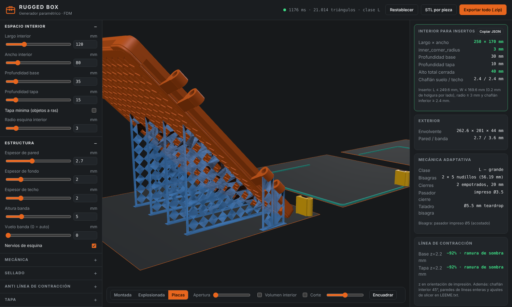
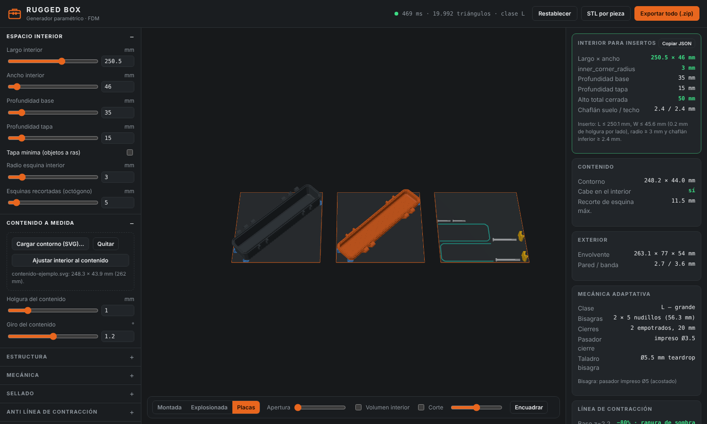

# Rugged Box

**Generador paramétrico de cajas de alta resistencia imprimibles en 3D (FDM).**
Defines el espacio interior y obtienes, en tiempo real, una caja completa con
bisagras, cierres autobloqueantes, junta hermética y compartimentos, lista
para imprimir **sin soportes y sin tornillería**.

**[Abrir el generador en el navegador](https://parra0713.github.io/parametric-rugged-box/)** · [Descargar la última versión](https://github.com/Parra0713/parametric-rugged-box/releases/latest)

[](LICENSE)
[](https://github.com/Parra0713/parametric-rugged-box/releases/latest)


## Contenido

- [Características](#características)
- [Empezar](#empezar)
- [Cómo se usa](#cómo-se-usa)
- [Impresión](#impresión)
- [Desarrollo](#desarrollo)
- [Cómo funciona](#cómo-funciona)
- [Contribuir](#contribuir)
- [Licencia y créditos](#licencia-y-créditos)

## Características

**La caja**

- Medidas **interiores** como entrada, con fondo propio para la base y la tapa.
- Bisagras de nudillos y **cierres de gancho autobloqueantes**, escalados
  solos según el tamaño (de 20 a 380 mm).
- Sellado con **junta de TPU impresa**, **cordón de filamento TPU de 1,75 mm**
  (no hay que imprimir la junta), laberinto doble o lengüeta simple.
- Esquinas redondeadas u **octogonales**, nervios de esquina, **apilable** y
  compatible con **Gridfinity** (placa base interior o pies).
- Tapa lisa, hexagonal, estriada, reforzada o sci‑fi, y **tu logo en SVG**,
  grabado o en relieve.
- **Modo ahorro de material** con diseño nervado que conserva la rigidez.

**El contenido**

- La base y la tapa llevan, cada una por separado: nada, un **inserto en
  blanco**, un **inserto con huecos a medida** de tus objetos o
  **compartimentos** con tapas interiores. Cualquier combinación.
- Huecos a medida desde el **calco SVG** de cada objeto (escala 1:1). Si son
  varios, se acomodan solos en el menor espacio, con huecos para los dedos.
- Tapas interiores con bisagra de pivotes, pozo para el dedo y traba
  **mecánica** (clic con retén) o **magnética** (imanes de disco del tamaño
  que elijas, con la cantidad sugerida o la que quieras).

**La impresión**

- Todas las piezas salen **orientadas y sin soportes**: agujeros en gota,
  voladizos ≤ 45° y puentes ≤ 10 mm.
- Si una pieza no cabe plana, se coloca **en diagonal** con orejas
  anti‑warping de retiro fácil o **inclinada** con bisel de contacto, aletas y
  soportes embebidos en el STL.
- **Test de holguras**: probetas que reproducen cada unión en su orientación
  real de impresión; el resultado se guarda como perfil de tu impresora.
- Ranura de sombra que disimula la línea de contracción entre fondo y paredes.

**La aplicación**

- Un único archivo `.html`: sin instalación y sin conexión a internet.
- Vista 3D montada, en despiece o en placas, con apertura animada y corte de
  sección.
- Deshacer y rehacer, modo claro y oscuro, accesible con teclado.
- Exporta STL por pieza o por placa y un `LEEME.txt` con los ajustes de
  impresión, el montaje y todo lo que hay que comprar o cortar aparte.

| | |
|---|---|
|  |  |
|  |  |

## Empezar

### En el navegador

Abre **https://parra0713.github.io/parametric-rugged-box/**. Nada se envía a
ningún servidor: la caja se calcula en tu navegador y tus ajustes se guardan
solo en él.

### Sin conexión

1. Descarga `rugged-box-vX.Y.Z.html` de la
   [última versión](https://github.com/Parra0713/parametric-rugged-box/releases/latest).
2. Ábrelo con doble clic en Chrome, Edge o Firefox.

Todo el programa, incluido el motor de geometría, va dentro de ese archivo.

### Desde el código

Requiere [Node.js](https://nodejs.org/) 20 o superior.

```bash
git clone https://github.com/Parra0713/parametric-rugged-box.git
cd parametric-rugged-box
npm install
npm run dev      # http://localhost:5173 con recarga automática
npm run build    # genera dist/rugged-box.html
```

## Cómo se usa

1. **Caja**: escribe el espacio interior que necesitas y la forma.
2. **Contenido**: elige qué lleva la base y qué lleva la tapa. Para huecos a
   medida, añade el calco SVG de cada objeto.
3. **Tapa**: patrón y logo.
4. **Mecánica**: tipo de sellado y robustez (automática por defecto).
5. **Impresión**: tu cama y, una vez por impresora y material, el test de
   holguras.
6. **Exportar todo**: abre las placas en tu laminador.

El panel derecho resume cómo se imprimirá cada pieza, los avisos y lo que
hace falta además de lo impreso (imanes, cordón, filamento para pasadores).

## Impresión

| Pieza | Material | Recomendación |
|---|---|---|
| Base y tapa | PETG, ASA o PLA | 0,2 mm, 4–6 perímetros, 15–25 % gyroid. La tapa, con la cara decorada sobre la cama. |
| Cierres | PETG | Acostados, como se exportan; 5 perímetros o más. |
| Pasadores | PETG o PLA | Acostados sobre la cara plana, 100 % de relleno. |
| Junta impresa | TPU 95A | Lenta, 100 % de relleno. Con «cordón» no se imprime: se corta filamento. |
| Tapas interiores | PETG o PLA | Cara exterior sobre la cama, 3 perímetros o más. |
| Insertos | PLA | 2 perímetros, 0 % de relleno. |

Cada exportación incluye un `LEEME.txt` con los ajustes y los pasos de montaje
de esa caja en concreto.

## Desarrollo

```bash
npm test               # geometría, cama, montaje, rendimiento, memoria e interfaz
npm run test:sweep     # barrido de 20 a 380 mm (resultado en logs/)
npm run test:org       # compartimentos: cierran, abren 0–95°, sin soportes
npm run test:ui        # interfaz en un navegador real (requiere Playwright)
```

```
index.html, src/main.js, src/viewer.js   interfaz y vista 3D (three.js)
src/worker.js, src/engineClient.js       hilos de geometría
src/engine/params.js                     parámetros, esquema de la interfaz y cotas
src/engine/engine.js                     orquestador de piezas y ayudas de impresión
src/engine/*.js                          bisagras, cierres, junta, tapa, insertos,
                                         compartimentos, calibración, inclinación
src/packer.js, src/content.js            acomodo de objetos y lectura de calcos
tests/                                   pruebas en Node y en navegador
docs/                                    diseño técnico y guía de interfaz
```

## Cómo funciona

La geometría se construye con [manifold‑3d](https://github.com/elalish/manifold)
(el motor CSG que también usa OpenSCAD) compilado a WebAssembly, en hilos
aparte para que la interfaz no se congele. Cada cambio produce primero una
vista rápida (~0,1 s) y luego el modelo completo al soltar el control.

El detalle de cada decisión (geometría de la bisagra, cierre autobloqueante,
dimensionado de la junta, impresión inclinada, modo ahorro, calibración,
compartimentos y trabas) está en **[docs/DISENO.md](docs/DISENO.md)**.

## Contribuir

Se agradecen issues y pull requests. Antes de abrir uno:

- Ejecuta `npm test` y, si tocas `src/engine/`, también `npm run test:sweep`.
- Si cambias la interfaz, sigue la
  [guía de interfaz](docs/GUIA-INTERFAZ.md) y pasa `npm run test:ui`.
- Una función nueva añade su caso a `tests/budget.test.mjs` (presupuesto de
  rendimiento).
- Para publicar una versión: sube `version` en `package.json` y `VERSION` en
  `src/engine/params.js`, compila (`npm run build`), escribe sus notas en
  `docs/releases/vX.Y.Z.md` y sube la etiqueta (`git tag vX.Y.Z` y
  `git push --tags`). La release y la página se actualizan solas.
- Textos de la interfaz, comentarios y mensajes de commit, en español.

## Licencia y créditos

[MIT](LICENSE).

Ideas y referencias de la comunidad: la
[Rugged Storage Box de Whity](https://printables.com/model/637028-rugged-storage-box-parametric-and-customizable),
la [Gridfinity Rugged Storage Box](https://www.printables.com/model/757297-gridfinity-rugged-storage-box-parametric-and-custo),
la [Parametric Tough Box](https://www.printables.com/model/731210-parametric-tough-box),
[Gridfinity](https://gridfinity.xyz/) de Zack Freedman y
[gridfinity-rebuilt-openscad](https://github.com/kennetek/gridfinity-rebuilt-openscad),
las [aletas de soporte](https://github.com/gittrahan/support-fins/wiki) de
M. Trahan y las
[Human Interface Guidelines](https://developer.apple.com/design/human-interface-guidelines/)
de Apple. Lista completa en [docs/DISENO.md](docs/DISENO.md#fuentes).
